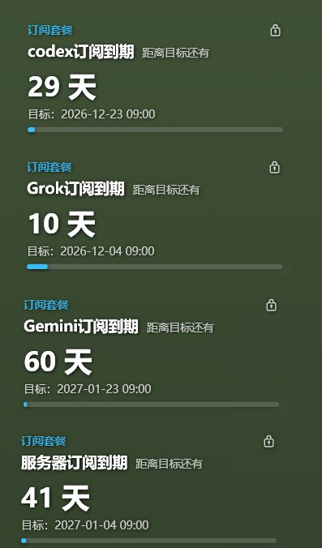

# DeskCountdown

轻量、纯净、绿色便携的 Windows 桌面倒计时与专注计时工具（C# / WPF）。

## 效果预览

<p align="center">
  
</p>

## 功能特性

- **倒计时 & 正计时双模式**：支持节日纪念日、考试备考、工作项目等多场景分类管理与关键词搜索，内置常用快捷模板。
- **多种时间显示格式**：支持 `天 + 时分秒`、`仅天数`、`年/月/日` 以及 `仅工作日（自动排除周末）`，可选显示进度条。
- **多任务桌面悬浮窗**：
  - 每个事项可独立开启/关闭桌面悬浮窗，自由拖拽与缩放，自动记忆位置和尺寸。
  - 支持 **置顶显示 / 普通层级 / 嵌入桌面底层**。
  - 支持 **锁定位置**、**鼠标穿透**、**一键隐藏/显示全部悬浮窗** 与 **一键全部解锁**。
- **高度自定义外观**：内置 6 套主题皮肤（含透明融入壁纸模式），支持自定义渐变背景色、文字色、强调色、透明度、字号、圆角及自定义背景图片。
- **专注计时器 / 番茄钟 & 秒表**：支持常用时长预设、自定义分钟倒计时、正向秒表计次（Lap）以及历史记录留存。
- **到期提醒与系统托盘**：支持提前提醒与到期桌面弹窗 + 提示音；支持最小化到系统托盘、可选开机自启。
- **绿色便携 & 数据导入导出**：所有配置与记录保存在程序同目录的 `countdown_data.json`，不占用系统盘；支持导出 UTF-8 BOM CSV 表格与 JSON 备份恢复。

## 运行与编译

### 环境要求
- Windows 7 / 10 / 11（系统自带 .NET Framework 4.x，无需安装额外运行时或 Visual Studio）

### 一键编译
在项目根目录运行 PowerShell：

```powershell
powershell -ExecutionPolicy Bypass -File .\build.ps1
```

编译完成后，会在 `dist\DeskCountdown.exe` 生成单文件可执行程序。

### 自检测试
```powershell
.\dist\DeskCountdown.exe --self-test
```

## 开源协议

本项目基于 [MIT License](LICENSE) 开源。
